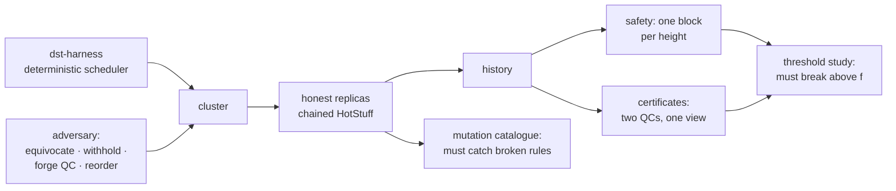

# hotstuff-bft

Chained HotStuff under an adversary that actively tries to break it, with a
threshold study that proves the adversary is strong enough to be worth trusting.

[](https://github.com/asp53826/hotstuff-bft/actions/workflows/ci.yml)


> A BFT implementation that passes its own tests has proved nothing. The tests
> could be weak, the adversary could be asleep, and both failure modes look
> exactly like success. So the first thing this repo measures is not whether
> safety holds — it is whether safety **breaks when it should**.

## The problem with testing consensus

Run a Byzantine protocol against a passive adversary and it will hold. Run it
against no adversary and it will hold. Publish "0 safety violations across
10,000 seeds" and you have published a number a completely broken
implementation could also produce.

That claim only means something if the same harness, pointed at a configuration
the protocol is *not* supposed to survive, reliably breaks it.

## Measured, not implied

### The adversary is strong enough

`n = 3f+1`, so safety is guaranteed at and below `f` Byzantine replicas and
guaranteed by nothing above it. 100 seeds per cell. The instrument is **two
quorum certificates in the same view** — the first thing that must become
possible once the Byzantine count passes the threshold.

**n = 4, f = 1 tolerated**

| byzantine | safe | violated | conflicting QCs | no progress | equivocated |
|---:|---:|---:|---|---:|---:|
| 0 | 98 | **0** | 0 runs / 0 | 2 | 100 |
| 1 | 99 | **0** | 0 runs / 0 | 1 | 100 |
| 2 | 19 | 0 | **98 runs / 562** | 81 | 100 |
| 3 | 0 | 0 | **100 runs / 247,938** | 0 | 100 |

**n = 7, f = 2 tolerated**

| byzantine | safe | violated | conflicting QCs | no progress | equivocated |
|---:|---:|---:|---|---:|---:|
| 0 | 99 | **0** | 0 runs / 0 | 1 | 100 |
| 1 | 95 | **0** | 0 runs / 0 | 5 | 100 |
| 2 | 98 | **0** | 0 runs / 0 | 2 | 100 |
| 3 | 73 | 0 | **77 runs / 189** | 27 | 100 |
| 4 | 26 | 0 | **96 runs / 725** | 74 | 100 |

Clean at and below `f`, broken immediately above it, in both cluster sizes.
`equivocated = 100` on every row including the clean ones — the adversary was
lying in every single run, it simply could not do damage while outnumbered.

Getting that instrument right took a correction. The first version counted
conflicting QCs at the same *height*, which fired even at zero Byzantine
replicas — two honest leaders in different views certifying different blocks is
ordinary forking, not a violation. Same view is the impossible one.

### The checkers are strong enough

Nine mutants that each break a specific safety-critical rule, plus one that
breaks a liveness rule and must *not* be flagged. 400 seeds per mutant,
n = 7, f = 2.

| mutant | caught at | what it removes |
|---|---:|---|
| `no_safety_rule` | seed 21 | the `safeNode` predicate |
| `no_lock_rule` | seed 21 | locking on the two-chain |
| `weak_quorum` | seed 1 | quorum size `2f+1` → `f+1` |
| `skip_qc_check` | seed 1 | certificate signature verification |
| `genesis_any_view` | **seed 182** | the genesis-QC view check |
| `no_liveness_rule` | *not flagged* | liveness clause — safety-preserving, correctly ignored |

**5 of 9 caught, 0 false positives**, control clean over 400 seeds.

`genesis_any_view` is the regression pin for a real bug this harness found in
this implementation, and it reproduces at the same seed that exposed the
original — 182.

## Three real bugs, with seeds

Written up in full in [BUGS.md](BUGS.md). In short:

1. **A genesis certificate was accepted at any view.** Certificate validation
   correctly exempted genesis from signature checking — genesis has no
   signatures — and thereby exempted it from the *view* check too. A Byzantine
   replica could fabricate `QC(genesis, view=999)`, which makes the liveness
   clause of the safety rule unconditionally true, which makes `safeNode`
   unconditionally true, which makes the lock meaningless. Two branches then
   commit at the same height. 1 violation in 300 seeds before, 0 in 400 after.

   Byzantine-specific in the exact sense that matters: under crash faults nobody
   fabricates a certificate that was never collected, so no amount of
   partition-and-crash testing reaches it.

2. **The commit rule did not require consecutive views.** It checked the
   three-chain was *structurally* direct but never that the certificates were
   formed in consecutive views, which is the condition the safety argument
   actually rests on.

3. **The adversary could not forge certificates**, which made a real check look
   unnecessary. `skip_qc_check` — removing signature verification — survived,
   because no Byzantine strategy ever sent an invalid certificate. The rule was
   fine; the adversary had no imagination. Adding a `forge_qc` strategy makes it
   caught at seed 1; in a clean run the adversary now sends 69 forged
   certificates and honest replicas reject 477.

## Where it loses

- **Four of nine safety-breaking mutants survive 400 seeds**:
  `vote_twice_per_view`, `allow_gaps_in_chain`, `trust_forwarded_proposals`,
  `unpersisted_vote`. Reported as uncaught rather than quietly dropped from the
  catalogue.
- **One of those four is a bug I actually fixed.** `allow_gaps_in_chain`
  re-introduces defect #2 above and the harness cannot catch it, so that fix is
  justified by the safety argument rather than by evidence from this repo.
  Saying so is the point — a catalogue listing only what you caught is a
  self-congratulation device.
- **No cryptography.** Signatures are replica identifiers in a set. Sufficient
  for the fault model, since a Byzantine replica cannot write another's
  identifier — but nothing here says anything about a real signature scheme.
- **Safety only, not liveness.** `no progress` is reported because it is
  diagnostically useful, but a run that commits nothing is not counted a
  failure. Liveness under partial synchrony needs bounds this simulator does not
  model.
- **Simulated network, not a real one.** Determinism comes from
  [dst-harness](https://github.com/asp53826/dst-harness); a real deployment
  brings clock skew, GC pauses and TCP behaviour none of this reproduces.
- **The threshold study proves the adversary can break safety above `f`. It does
  not prove it would find every bug at or below `f`.** Different claims, and
  only the first is measured here.

## Verify it

```bash
make test       # 41 tests
make threshold  # the safety cliff
make mutation   # the mutation catalogue
```

## How it fits together



The dependency on `dst-harness` is real rather than decorative — this repo is
the second consumer of that framework and imports it straight from GitHub.

## License

MIT
